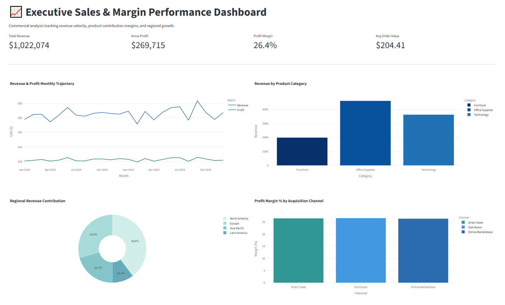

# Executive Sales & Margin Performance Dashboard

An interactive commercial analytics web application built with Python, Streamlit, and Plotly to track multi-region sales performance, product margins, and channel acquisition economics.

---

## 📌 Executive Overview

Designed for executive decision-makers, this business dashboard bridges granular transactional records with high-level commercial KPIs:
* **Margin Integrity:** Isolates high-volume categories suffering from margin compression vs. high-yield product lines.
* **Regional Dynamics:** Identifies geographical revenue contribution across primary global territories.
* **Channel Profitability:** Compares net margin realization across Direct Sales, Online Marketplaces, and Partner Distributors.

---

## 📊 Dashboard Preview



---

## 🔍 Key Business Metrics Tracked

| Metric | Calculation | Strategic Business Purpose |
| :--- | :--- | :--- |
| **Gross Revenue** | $\sum \text{Sales Quantity} \times \text{Unit Price}$ | Evaluates top-line commercial scale and period velocity |
| **Gross Margin %** | $(\text{Total Profit} / \text{Total Revenue}) \times 100$ | Protects profitability against aggressive discounting |
| **Average Order Value (AOV)** | $\text{Total Revenue} / \text{Transaction Count}$ | Benchmarks basket sizing across sales channels |
| **Channel Profitability** | $\text{Channel Profit} / \text{Channel Revenue}$ | Informs CAC allocation and sales commission structures |

---

## 🛠 Tech Stack

* **Application Framework:** Streamlit
* **Interactive Data Visualization:** Plotly Express
* **Data Processing:** Python / Pandas / NumPy
* **Deployment Ready:** Configured for Streamlit Cloud / local execution

---

## 🚀 How to Run Locally

1. **Clone repository:**
   ```bash
   git clone [https://github.com/olehishchenko/executive-sales-dashboard.git](https://github.com/olehishchenko/executive-sales-dashboard.git)
   cd executive-sales-dashboard